# Technical Design Document
## Agentic Federated Learning Framework for Privacy-Preserving Fraud Detection in CBDC Networks

**Version:** 1.1  
**Date:** February 2026  
**Author:** WAD Dusman Nalin Dayawansha (K2557706)  
**Supervisor:** Dr. Madhawa Ranawake  
**Institution:** Kingston University  
**Document Status:** Draft for Review

---

## Table of Contents

1. [Executive Summary](#1-executive-summary)
   - [Research Context](#11-research-context)
2. [System Architecture Overview](#2-system-architecture-overview)
3. [Component Specifications](#3-component-specifications)
4. [Data Architecture](#4-data-architecture)
   - [Test Data Architecture](#44-test-data-architecture)
5. [Privacy-Preserving Mechanisms](#5-privacy-preserving-mechanisms)
6. [Agentic AI Design](#6-agentic-ai-design)
7. [Graph Neural Network Architecture](#7-graph-neural-network-architecture)
8. [Federated Learning Pipeline](#8-federated-learning-pipeline)
9. [Communication Protocol](#9-communication-protocol)
10. [Implementation Roadmap](#10-implementation-roadmap)
11. [Evaluation Framework](#11-evaluation-framework)
12. [Technology Stack](#12-technology-stack)
13. [Project Deliverables](#13-project-deliverables)
14. [Expected Outcomes and Limitations](#14-expected-outcomes-and-limitations)

---

## 1. Executive Summary

This technical design document outlines the architecture and implementation strategy for an **Agentic Federated Learning Framework** designed to detect fraud in Central Bank Digital Currency (CBDC) networks while preserving privacy and regulatory compliance.

### Key Design Principles

| Principle | Description |
|-----------|-------------|
| **Privacy-First** | No raw transaction data leaves institutional boundaries |
| **Autonomous Coordination** | Agentic AI manages training without human intervention |
| **Adaptive Learning** | System evolves to detect new fraud patterns |
| **Regulatory Compliance** | GDPR, PSD2, and banking regulation compliant |
| **Scalable Architecture** | Supports multiple institutions and high transaction volumes |

---

## 1.1 Research Context

### Research Aim

To develop an Agentic Federated Learning framework that enables privacy-preserving, adaptive, and collaborative fraud detection across Central Bank Digital Currency (CBDC) ecosystems without requiring institutions to share sensitive transaction data.

### Research Objectives

| Objective | Description |
|-----------|-------------|
| **RO1** | Develop a Federated Learning Framework for CBDC fraud detection enabling distributed learning without sharing raw transaction data |
| **RO2** | Develop Agentic AI capabilities for managing training rounds, monitoring model behavior, and adapting the learning workflow with minimal human intervention |
| **RO3** | Develop privacy-preserving training pipelines using encrypted model updates, differential privacy, or secure aggregation |
| **RO4** | Develop a working prototype demonstrating federated learning and agentic coordination in a privacy-preserving CBDC-like environment |

### SMART Objectives

| Criterion | Target |
|-----------|--------|
| **Specific** | Implement a federated GNN-based fraud detection prototype |
| **Measurable** | Evaluate using Precision, Recall, F1-score, and ROC-AUC |
| **Achievable** | Use synthetic and open-source datasets (Elliptic++) for simulation |
| **Relevant** | Address privacy and compliance challenges in CBDC systems |
| **Time-bound** | Complete design, implementation, and evaluation by September 2026 |

### Research Methodology

This project adopts a **Design Science Research (DSR)** approach, focusing on designing, developing, and evaluating a novel Agentic Federated Learning framework for fraud detection in CBDC networks. The study is applied and experimental, aiming to address real-world privacy and regulatory challenges in digital finance.

---

## 2. System Architecture Overview

> [!TIP]
> The architecture diagrams below can be found in the `doc/design/` folder for high-resolution versions.

### 2.1 System Architecture Diagram

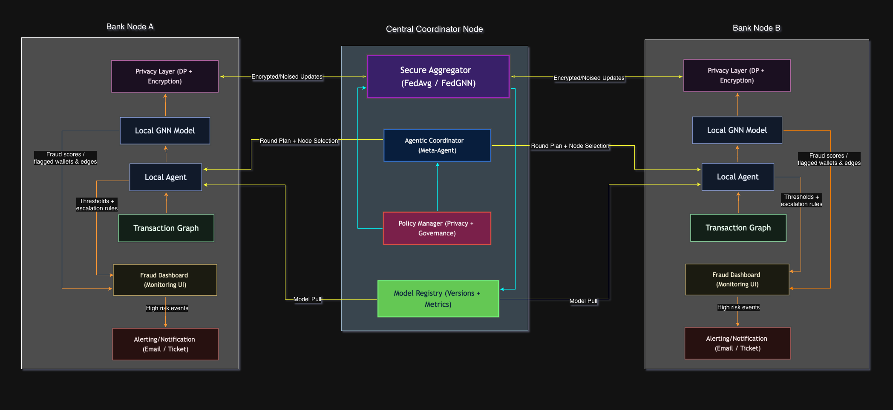

### 2.2 Sequence Diagram


### 2.3 High-Level Architecture

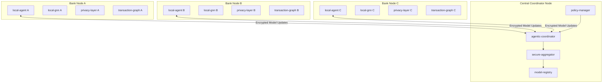

### 2.2 Deployment Topology

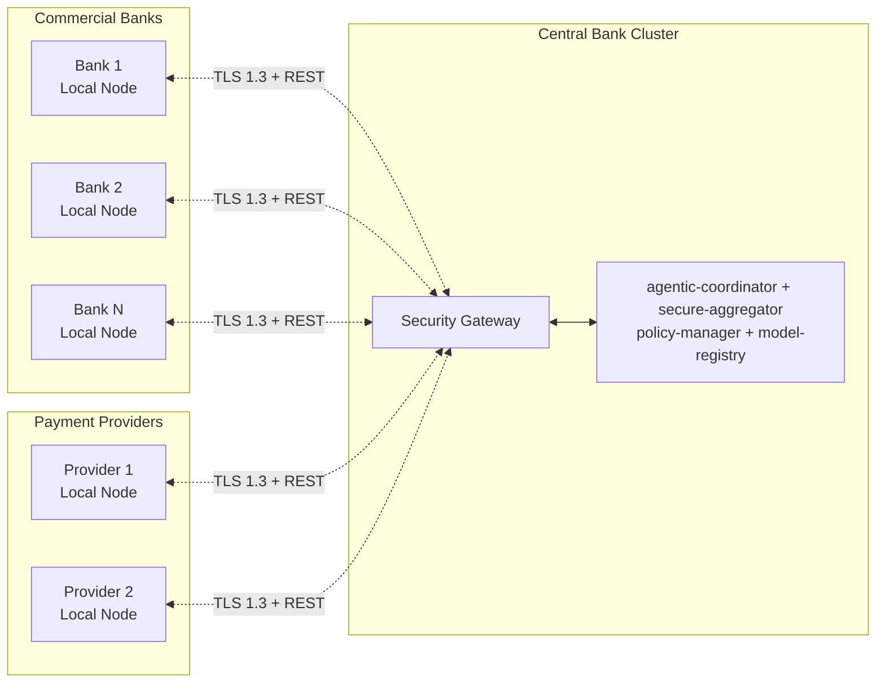

---

## 3. Component Specifications

### 3.1 Component Overview

| Component | Responsibility | Technology |
|-----------|---------------|------------|
| **Local Agent** | Autonomous training, anomaly detection, model updates | Python, PyTorch |
| **Local GNN** | Transaction graph analysis, fraud pattern detection | PyTorch Geometric |
| **Agentic Coordinator** | Training orchestration, round scheduling, conflict resolution | LangChain/AutoGen |
| **Secure Aggregator** | Secure model aggregation, weight averaging | Flower Framework |
| **Privacy Layer** | Differential privacy, secure aggregation | PySyft, Opacus |
| **Transaction Graph** | Graph representation of transactions | NetworkX, DGL |

### 3.2 Local Agent Specification

```
┌─────────────────────────────────────────────────────────────┐
│                        LOCAL AGENT                          │
├─────────────────────────────────────────────────────────────┤
│  ┌─────────────────┐  ┌─────────────────┐  ┌─────────────┐ │
│  │   Perception    │  │    Reasoning    │  │   Action    │ │
│  │     Module      │  │     Engine      │  │   Module    │ │
│  └────────┬────────┘  └────────┬────────┘  └──────┬──────┘ │
│           │                    │                   │        │
│           ▼                    ▼                   ▼        │
│  ┌─────────────────────────────────────────────────────┐   │
│  │              Agent State Memory                      │   │
│  │  • Training history  • Fraud patterns detected       │   │
│  │  • Model performance • Coordination messages         │   │
│  └─────────────────────────────────────────────────────┘   │
├─────────────────────────────────────────────────────────────┤
│  Interfaces:                                                │
│  • receive_global_model() → Model                          │
│  • train_local_model(data) → ModelUpdate                   │
│  • apply_differential_privacy(update) → PrivateUpdate      │
│  • send_update_to_coordinator() → ACK                      │
│  • evaluate_local_performance() → Metrics                   │
│  • adapt_to_new_patterns() → void                          │
└─────────────────────────────────────────────────────────────┘
```

### 3.3 Agentic Coordinator Specification

```python
class AgenticCoordinator:
    """
    Meta-agent responsible for autonomous federated learning orchestration.
    
    Responsibilities:
    - Round scheduling and management
    - Agent selection for each round
    - Anomaly detection in model updates
    - Adaptive aggregation strategies
    - Conflict resolution between agents
    """
    
    def __init__(self):
        self.reasoning_engine = ReasoningEngine()  # LLM-based decision making
        self.policy_manager = PolicyManager()       # Regulatory compliance
        self.aggregator = SecureAggregator()        # Privacy-preserving aggregation
        self.agent_registry = AgentRegistry()       # Track participating agents
        
    async def orchestrate_round(self) -> GlobalModel:
        """Autonomously manage a single federated learning round."""
        pass
        
    async def detect_malicious_updates(self, updates: List[ModelUpdate]) -> List[bool]:
        """Identify poisoning attacks or Byzantine agents."""
        pass
        
    async def adapt_aggregation_strategy(self, performance_metrics: Dict) -> Strategy:
        """Dynamically adjust aggregation based on performance."""
        pass
```

---

## 4. Data Architecture

### 4.1 Transaction Graph Schema

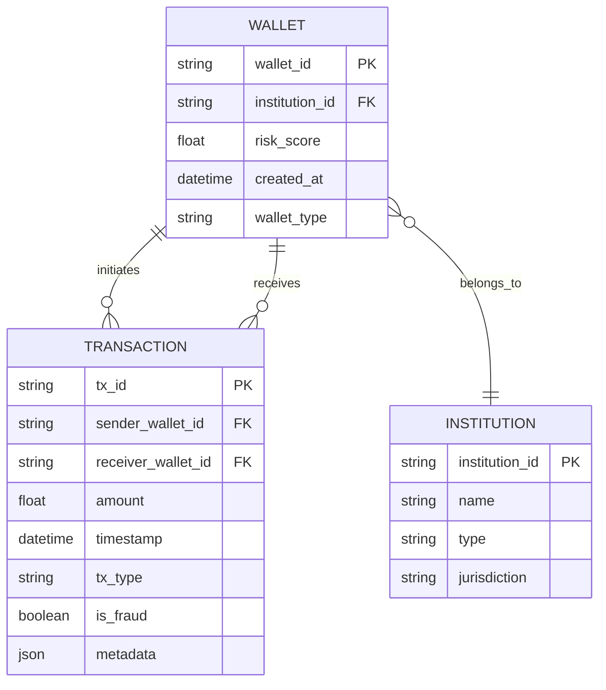

### 4.2 Graph Representation

| Element | Representation | Features |
|---------|---------------|----------|
| **Nodes (Wallets)** | Graph vertices | `risk_score`, `tx_count`, `avg_amount`, `wallet_age`, `institution_type` |
| **Edges (Transactions)** | Directed edges | `amount`, `timestamp`, `tx_type`, `frequency`, `deviation_score` |
| **Subgraphs** | Institution partitions | Local transaction clusters per bank |

### 4.3 Feature Engineering

```python
# Node Features (per wallet)
node_features = {
    'degree_centrality': float,        # Network importance
    'transaction_velocity': float,     # Tx/hour
    'amount_variance': float,          # Spending pattern variance
    'counterparty_diversity': int,     # Unique transaction partners
    'temporal_pattern': List[float],   # Time-series encoding
    'historical_fraud_proximity': float # Distance to known fraud nodes
}

# Edge Features (per transaction)
edge_features = {
    'amount_normalized': float,        # Institution-relative amount
    'time_of_day': float,              # Hour encoding
    'day_of_week': int,                # Day encoding
    'is_cross_border': bool,           # Cross-jurisdiction flag
    'round_amount_flag': bool,         # Suspicious round numbers
    'velocity_anomaly': float          # Deviation from normal patterns
}
```

---

## 4.4 Test Data Architecture

### Data Source

The **Elliptic++ Dataset** is used as the primary data source for this research.  
- **Source:** https://github.com/git-disl/EllipticPlusPlus  
- The dataset represents a large-scale transaction graph derived from blockchain activity, with labeled illicit and licit transactions.
- Selected due to suitability for graph-based fraud detection and temporal analysis.

### CBDC Simulation Assumptions

| Blockchain Element | CBDC Mapping |
|--------------------|---------------|
| Wallet addresses | CBDC accounts |
| Transactions | Digital currency transfers |
| Fraud labels | Illicit activity within regulated digital payment context |

### Data Preparation Pipeline

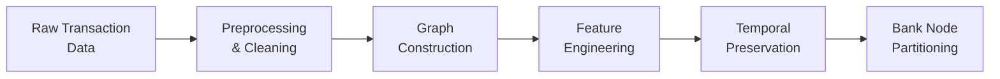

| Step | Description |
|------|-------------|
| **Preprocessing** | Ensure consistency, completeness, and usability |
| **Graph Construction** | Transform records into graph structures suitable for GNN training |
| **Temporal Preservation** | Preserve time information to reflect evolving transaction behavior |
| **Feature Normalization** | Apply normalization and label filtering |
| **Partitioning** | Distribute data across simulated Bank Nodes |

---

## 5. Privacy-Preserving Mechanisms

### 5.1 Privacy Stack Architecture

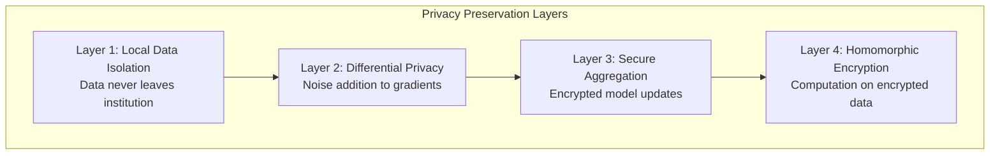

### 5.2 Differential Privacy Implementation

| Parameter | Value | Rationale |
|-----------|-------|-----------|
| **ε (Epsilon)** | 1.0 - 8.0 | Privacy budget (lower = more private) |
| **δ (Delta)** | 10⁻⁵ | Probability of privacy breach |
| **Noise Mechanism** | Gaussian | Better composition properties |
| **Clipping Norm** | Adaptive | Based on gradient distribution |

```python
class DifferentialPrivacyModule:
    """
    Applies differential privacy to model gradients before sharing.
    """
    
    def __init__(self, epsilon: float = 1.0, delta: float = 1e-5):
        self.epsilon = epsilon
        self.delta = delta
        self.noise_multiplier = self._compute_noise_multiplier()
        
    def privatize_gradients(self, gradients: torch.Tensor, 
                            max_norm: float) -> torch.Tensor:
        """Apply gradient clipping and Gaussian noise."""
        # Clip gradients to bound sensitivity
        clipped = self._clip_gradients(gradients, max_norm)
        
        # Add calibrated Gaussian noise
        noise = torch.normal(0, self.noise_multiplier * max_norm, 
                            size=clipped.shape)
        return clipped + noise
```

### 5.3 Secure Aggregation Protocol

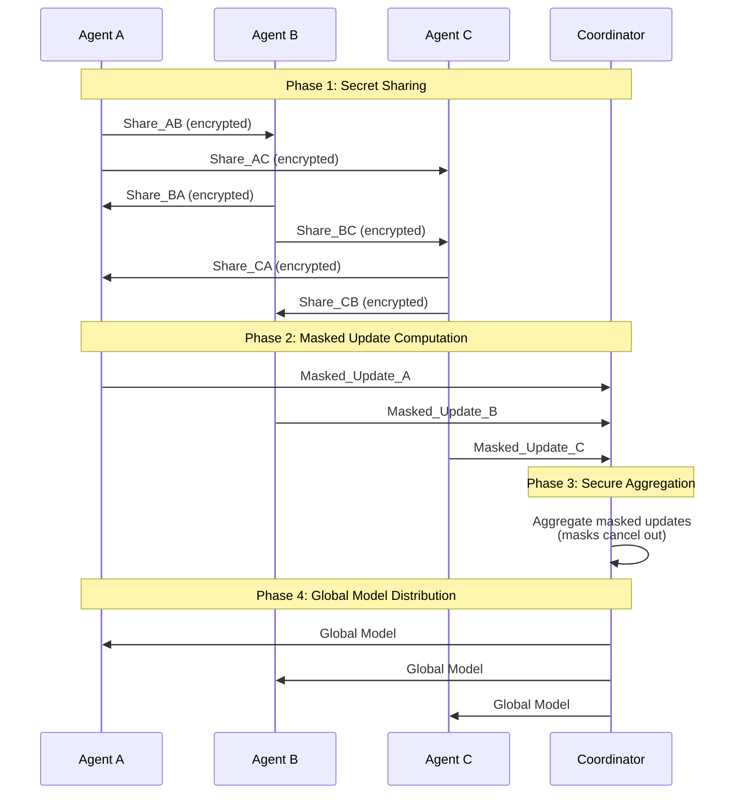

---

## 6. Agentic AI Design

### 6.1 Agent Architecture

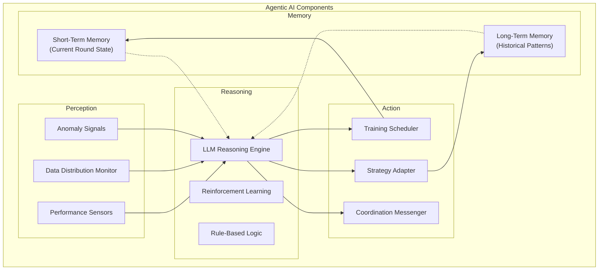

### 6.2 Autonomous Decision Engine

| Decision Type | Trigger | Agent Action |
|---------------|---------|--------------|
| **Round Participation** | Coordinator request | Evaluate local data quality, decide participation |
| **Training Intensity** | Poor local performance | Increase epochs, adjust learning rate |
| **Anomaly Escalation** | Unusual pattern detected | Alert coordinator, share anonymized pattern |
| **Model Rejection** | Model degradation | Reject global update, request re-aggregation |
| **Strategy Adaptation** | New fraud patterns | Modify local training approach |

### 6.3 Multi-Agent Coordination Protocol

```python
class CoordinationProtocol:
    """
    Defines how agents communicate and coordinate.
    """
    
    # Message Types
    ROUND_INITIATION = "round_init"
    MODEL_UPDATE = "model_update"
    ANOMALY_ALERT = "anomaly_alert"
    PERFORMANCE_REPORT = "perf_report"
    STRATEGY_SUGGESTION = "strategy_suggest"
    
    async def negotiate_aggregation_weights(self, 
                                            agents: List[Agent]) -> Dict[str, float]:
        """
        Agents negotiate contribution weights based on:
        - Data quality
        - Model performance
        - Historical reliability
        """
        pass
    
    async def consensus_on_fraud_pattern(self, 
                                         pattern: FraudPattern) -> bool:
        """
        Multi-agent consensus on new fraud pattern classification.
        Requires majority agreement to update global taxonomy.
        """
        pass
```

---

## 7. Graph Neural Network Architecture

### 7.1 GNN Model Architecture

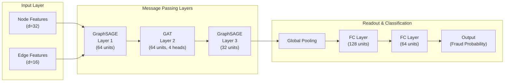

### 7.2 Model Specification

```python
class FraudDetectionGNN(torch.nn.Module):
    """
    Graph Neural Network for CBDC fraud detection.
    
    Architecture:
    - GraphSAGE for efficient neighborhood aggregation
    - Graph Attention for importance weighting
    - Edge-conditioned convolution for transaction features
    """
    
    def __init__(self, 
                 node_features: int = 32,
                 edge_features: int = 16,
                 hidden_dim: int = 64,
                 num_heads: int = 4,
                 dropout: float = 0.3):
        super().__init__()
        
        # Message Passing Layers
        self.conv1 = SAGEConv(node_features, hidden_dim)
        self.conv2 = GATConv(hidden_dim, hidden_dim, heads=num_heads)
        self.conv3 = SAGEConv(hidden_dim * num_heads, hidden_dim // 2)
        
        # Edge Feature Integration
        self.edge_encoder = nn.Linear(edge_features, hidden_dim)
        
        # Classification Head
        self.classifier = nn.Sequential(
            nn.Linear(hidden_dim // 2, 128),
            nn.ReLU(),
            nn.Dropout(dropout),
            nn.Linear(128, 64),
            nn.ReLU(),
            nn.Dropout(dropout),
            nn.Linear(64, 1),
            nn.Sigmoid()
        )
    
    def forward(self, x, edge_index, edge_attr, batch):
        # Message passing with edge features
        edge_embed = self.edge_encoder(edge_attr)
        
        h = F.relu(self.conv1(x, edge_index))
        h = F.dropout(h, p=0.3, training=self.training)
        
        h = F.relu(self.conv2(h, edge_index))
        h = F.dropout(h, p=0.3, training=self.training)
        
        h = self.conv3(h, edge_index)
        
        # Global pooling
        h = global_mean_pool(h, batch)
        
        # Classification
        return self.classifier(h)
```

### 7.3 Federated GNN Training Strategy

| Strategy | Description | Use Case |
|----------|-------------|----------|
| **FedAvg-GNN** | Average model weights across institutions | Homogeneous data distribution |
| **FedProx-GNN** | Regularized averaging for heterogeneity | Non-IID transaction patterns |
| **FedGraph** | Graph structure-aware aggregation | Preserving local graph topology |

---

## 8. Federated Learning Pipeline

### 8.1 Training Workflow

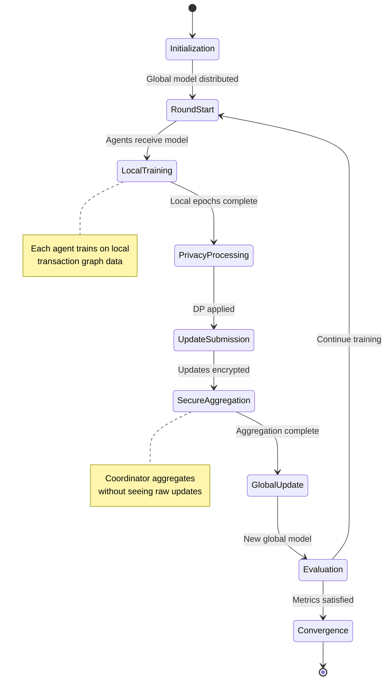

### 8.2 Round Configuration

```yaml
federated_learning_config:
  # Round Parameters
  rounds_total: 100
  min_agents_per_round: 3
  agent_selection: "random"  # random | performance-based | all
  
  # Local Training
  local_epochs: 5
  local_batch_size: 32
  local_learning_rate: 0.001
  optimizer: "adam"
  
  # Aggregation
  aggregation_strategy: "fedavg"  # fedavg | fedprox | scaffold
  fedprox_mu: 0.01  # Proximal term coefficient
  
  # Privacy
  differential_privacy:
    enabled: true
    epsilon: 2.0
    delta: 1e-5
    max_grad_norm: 1.0
  
  secure_aggregation:
    enabled: true
    protocol: "shamir_secret_sharing"
    threshold: 2  # Minimum agents for reconstruction
  
  # Convergence
  early_stopping:
    enabled: true
    patience: 10
    min_delta: 0.001
    metric: "f1_score"
```

### 8.3 Agent Selection Strategy

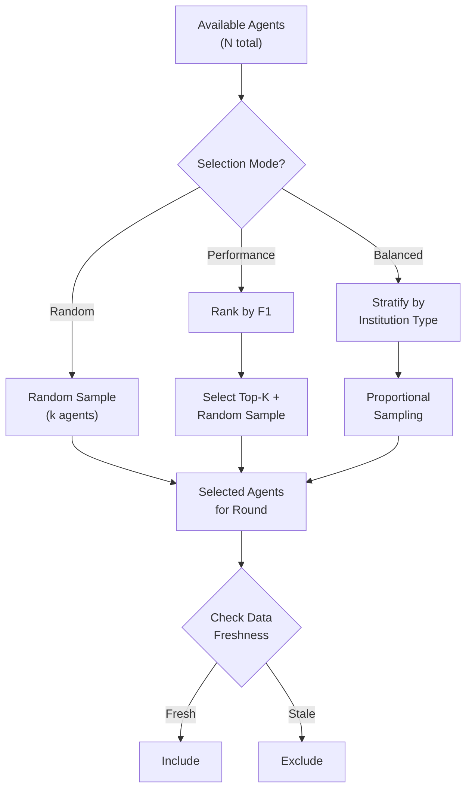

---

## 9. Communication Protocol

### 9.1 Message Format

```json
{
  "model_update": {
    "agent_id": "bank-01",
    "round_number": 2,
    "encrypted_weights": "base64-encoded-model-payload",
    "local_metrics": {
      "accuracy": 0.94,
      "precision": 0.91,
      "recall": 0.89,
      "f1_score": 0.90,
      "roc_auc": 0.96,
      "fraud_cases_detected": 34,
      "false_positives": 3
    },
    "samples_trained": 12000,
    "differential_privacy_proof": "base64-encoded-proof",
    "timestamp": "2026-06-13T10:30:00Z"
  },
  "coordinator_command": {
    "command_type": "START_ROUND",
    "global_model": "base64-encoded-global-model",
    "config": {
      "round_id": "round-02",
      "epochs": 1
    },
    "target_agents": ["bank-01", "bank-02"]
  },
  "anomaly_alert": {
    "agent_id": "bank-01",
    "anomaly_type": "MODEL_DEGRADATION",
    "confidence": 0.82,
    "anonymized_pattern": "base64-encoded-pattern"
  }
}
```

### 9.2 Network Security

| Layer | Mechanism | Purpose |
|-------|-----------|---------|
| **Transport** | TLS 1.3 with mTLS | Encrypted communication |
| **Authentication** | X.509 Certificates | Agent identity verification |
| **Message Integrity** | HMAC-SHA256 | Tamper detection |
| **Payload Encryption** | AES-256-GCM | Model update confidentiality |
| **Key Management** | HSM-backed PKI | Secure key storage |

---

## 10. Implementation Roadmap

### 10.1 Phase Overview

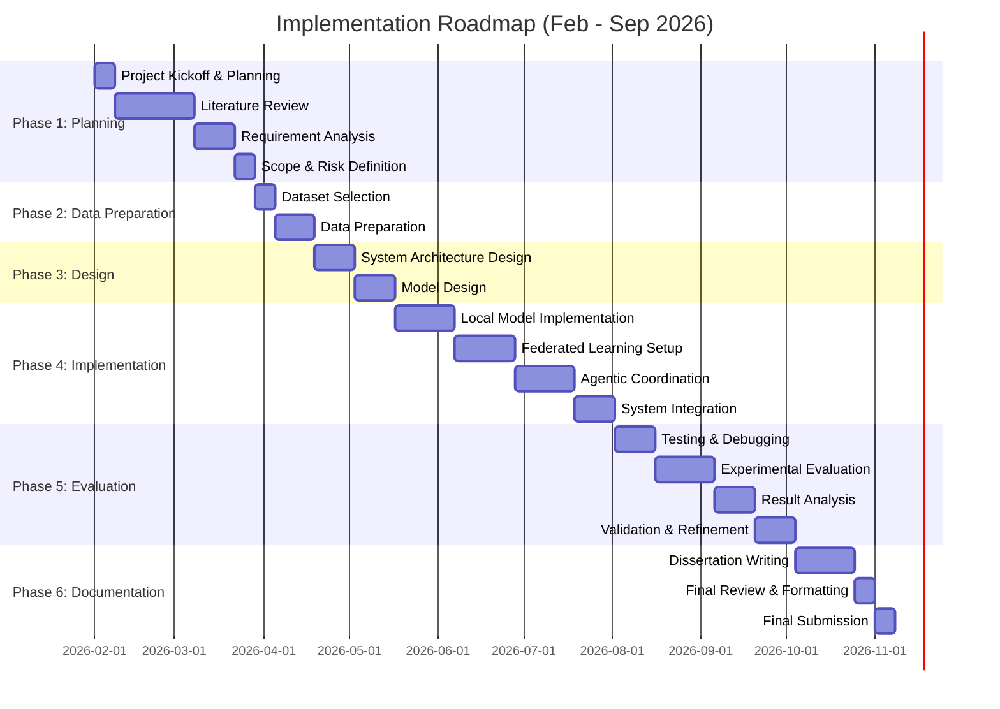

### 10.2 Detailed Work Plan

| Phase | Activity | Description | Duration | Timeline |
|------:|----------|-------------|----------|----------|
| 1 | Project Kickoff & Planning | Finalize scope, milestones, and supervisor alignment | 1 week | Early Feb 2026 |
| 2 | Literature Review | Review CBDCs, fraud detection, FL, GNNs, and agentic AI | 4 weeks | Feb – Early Mar 2026 |
| 3 | Requirement Analysis | Identify functional, technical, privacy, and regulatory needs | 2 weeks | Mar 2026 |
| 4 | Scope & Risk Definition | Refine objectives and identify key risks | 1 week | Late Mar 2026 |
| 5 | Dataset Selection | Review Elliptic++ dataset and define CBDC simulation assumptions | 1 week | Early Apr 2026 |
| 6 | Data Preparation | Data cleaning, feature preparation, and graph construction | 2 weeks | Apr 2026 |
| 7 | System Architecture Design | Design federated architecture and agentic workflow | 2 weeks | Late Apr 2026 |
| 8 | Model Design | Design GNN-based fraud detection model | 2 weeks | Early May 2026 |
| 9 | Local Model Implementation | Implement and validate local GNN models | 3 weeks | May – Early Jun 2026 |
| 10 | Federated Learning Setup | Configure FL workflow and aggregation strategy | 3 weeks | Jun 2026 |
| 11 | Agentic Coordination Implementation | Implement agentic coordinator and local agents | 3 weeks | Jun – Early Jul 2026 |
| 12 | System Integration | Integrate GNN, FL, and agentic components | 2 weeks | Mid Jul 2026 |
| 13 | Testing & Debugging | Functional testing and system stabilization | 2 weeks | Late Jul 2026 |
| 14 | Experimental Evaluation | Evaluate fraud detection and privacy behavior | 3 weeks | Aug 2026 |
| 15 | Result Analysis | Analyze experimental results and findings | 2 weeks | Late Aug 2026 |
| 16 | Validation & Refinement | Validate results and refine system | 2 weeks | Early Sep 2026 |
| 17 | Dissertation Writing | Finalize dissertation chapters | 3 weeks | Sep 2026 |
| 18 | Final Review & Formatting | Proofreading, formatting, and final checks | 1 week | Late Sep 2026 |
| 19 | Final Submission | Dissertation submission | 1 week | End of Sep 2026 |

### 10.3 Milestone Deliverables

| Phase | Milestone | Deliverable |
|-------|-----------|-------------|
| **Phase 1-2** | M1: Data Ready | Elliptic++ dataset prepared as CBDC transaction graph |
| **Phase 3** | M2: FL Baseline | Working Flower-based federated learning setup |
| **Phase 4** | M3: GNN Prototype | Trained GNN model with baseline fraud detection |
| **Phase 4** | M4: Privacy Integration | DP and secure aggregation functional |
| **Phase 4** | M5: Agentic Coordination | Meta-agent orchestrating training rounds |
| **Phase 4** | M6: Adaptive System | Self-improving fraud detection pipeline |
| **Phase 5** | M7: Evaluation Complete | Performance report, comparison with baselines |
| **Phase 6** | M8: Dissertation Submitted | Final MSc dissertation |

---

## 11. Evaluation Framework

### 11.1 Evaluation Metrics

| Category | Metric | Target |
|----------|--------|--------|
| **Detection Performance** | Accuracy | ≥ 95% |
| | Precision | ≥ 90% |
| | Recall | ≥ 85% |
| | F1-Score | ≥ 87% |
| | ROC-AUC | ≥ 0.92 |
| **Privacy** | ε-Differential Privacy | ε ≤ 4.0 |
| | Information Leakage | < 0.1% |
| **Efficiency** | Communication Cost | < 10MB/round |
| | Convergence Rounds | < 50 rounds |
| | Training Time/Round | < 5 minutes |
| **Adaptability** | New Pattern Detection | < 3 rounds |
| | False Positive Rate | < 5% |

### 11.2 Baseline Comparisons

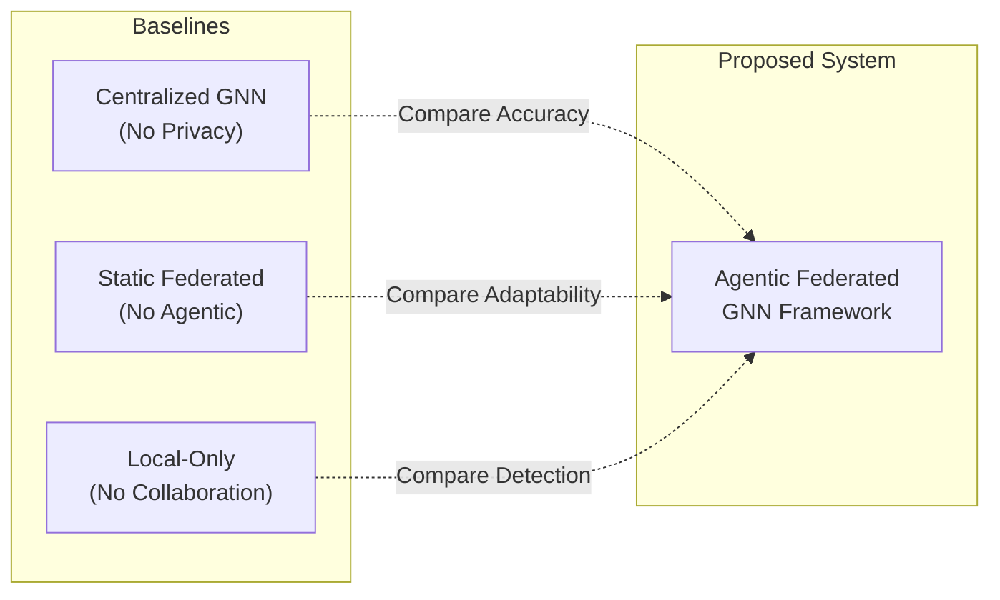

### 11.3 Evaluation Experiments

| Experiment | Objective | Setup |
|------------|-----------|-------|
| **E1: Detection Accuracy** | Compare fraud detection with baselines | 5 simulated banks, 100K transactions |
| **E2: Privacy Analysis** | Measure information leakage | Membership inference attacks |
| **E3: Scalability Test** | Assess performance with more nodes | 10, 20, 50 bank nodes |
| **E4: Adaptive Learning** | Test response to new fraud patterns | Inject novel fraud after round 50 |
| **E5: Byzantine Resilience** | Test against malicious agents | 20% compromised agents |

---

## 12. Technology Stack

### 12.1 Core Technologies

| Category | Technology | Version | Purpose |
|----------|------------|---------|---------|
| **Language** | Python | 3.10+ | Primary development |
| **Deep Learning** | PyTorch | 2.0+ | Neural network training |
| **Graph Learning** | PyTorch Geometric | 2.3+ | GNN implementation |
| **Federated Learning** | Flower | 1.5+ | FL orchestration |
| **Privacy** | Opacus | 1.4+ | Differential privacy |
| **Secure Computation** | PySyft | 0.8+ | Secure aggregation |
| **Graph Processing** | NetworkX | 3.0+ | Graph manipulation |
| **Agent Framework** | LangChain | 0.1+ | Agentic reasoning |
| **Visualization** | PyVis | 0.3+ | Fraud network visualization |

### 12.2 Infrastructure Technologies

| Category | Technology | Purpose |
|----------|------------|---------|
| **Frontend Dashboard** | React.js | Fraud monitoring and analytics dashboard |
| **Event Streaming** | Apache Kafka | CDC-based message propagation and decoupled service communication |
| **Change Data Capture** | CDC | Capture transaction state changes across distributed services |
| **Synchronous Communication** | HTTP/REST | Real-time service-to-service interactions |
| **Containerization** | Docker | Portability, reproducibility, consistent execution |
| **Orchestration** | Kubernetes (K8s) | Horizontal scaling, fault tolerance, resilient service management |
| **CI/CD** | GitHub Actions + Jenkins | Automated build, testing, and deployment workflows |

### 12.2 Development Environment

```yaml
# environment.yml
name: cbdc-fraud-detection
channels:
  - pytorch
  - pyg
  - conda-forge
dependencies:
  - python=3.10
  - pytorch>=2.0
  - torchvision
  - numpy
  - pandas
  - scikit-learn
  - networkx
  - jupyter
  - pip:
    - torch-geometric
    - flwr
    - opacus
    - pysyft
    - langchain
    - pyvis
    - cryptography
```

### 12.3 Project Structure

```
cbdc-fraud-detection/
├── config/
│   ├── federated.yaml         # FL configuration
│   ├── privacy.yaml           # Privacy parameters
│   └── model.yaml             # GNN architecture
├── src/
│   ├── agents/
│   │   ├── local_agent.py     # Local training agent
│   │   ├── coordinator.py     # Agentic coordinator
│   │   └── protocols.py       # Communication protocols
│   ├── models/
│   │   ├── gnn.py             # GNN architecture
│   │   ├── federated_gnn.py   # Federated GNN wrapper
│   │   └── layers.py          # Custom GNN layers
│   ├── privacy/
│   │   ├── differential.py    # Differential privacy
│   │   ├── secure_agg.py      # Secure aggregation
│   │   └── encryption.py      # Cryptographic utilities
│   ├── data/
│   │   ├── generator.py       # Synthetic data generation
│   │   ├── graph_builder.py   # Transaction graph construction
│   │   └── loader.py          # Data loading utilities
│   └── utils/
│       ├── visualization.py   # Network visualization
│       ├── metrics.py         # Evaluation metrics
│       └── logging.py         # Experiment logging
├── experiments/
│   ├── baseline_comparison.py
│   ├── scalability_test.py
│   └── adaptive_learning.py
├── notebooks/
│   ├── 01_data_exploration.ipynb
│   ├── 02_gnn_development.ipynb
│   ├── 03_federated_training.ipynb
│   └── 04_evaluation.ipynb
├── tests/
│   ├── test_agents.py
│   ├── test_models.py
│   └── test_privacy.py
├── docs/
│   ├── TECHNICAL-DESIGN.md    # This document
│   └── API.md                 # API documentation
├── requirements.txt
├── setup.py
└── README.md
```

---

## 13. Project Deliverables

| # | Deliverable | Description |
|---|-------------|-------------|
| 1 | **Approved Project Proposal** | Formal document defining research problem, objectives, methodology, and work plan |
| 2 | **Agentic Federated Learning Prototype** | Functional proof-of-concept demonstrating privacy-preserving fraud detection using FL and GNNs in simulated CBDC environment |
| 3 | **Experimental Evaluation Results** | Quantitative and qualitative evaluation demonstrating effectiveness and feasibility |
| 4 | **Final MSc Dissertation** | Comprehensive written report documenting research background, methodology, system design, results, discussion, and conclusions |

---

## 14. Expected Outcomes and Limitations

### 14.1 Expected Outcomes

- Demonstrate feasibility of an agentic federated learning framework for fraud detection in CBDC environments
- Show how collaborative learning can be achieved without sharing sensitive transaction data
- Support adaptive and privacy-preserving fraud detection under regulatory constraints (GDPR, PSD2)

### 14.2 Limitations

| Limitation | Impact |
|------------|--------|
| **Simulated Data** | Evaluation based on simulated CBDC behavior using public datasets rather than real central bank data |
| **Data Heterogeneity** | Performance may be influenced by data heterogeneity and limited label availability |
| **Prototype Scope** | Focus on technical feasibility rather than full-scale production deployment |

### 14.3 Future Work

- Extension to real CBDC pilot environments
- Exploration of advanced privacy techniques (FHE, blockchain-based coordination)
- Long-term evaluation under concept drift and evolving fraud patterns
- Integration with regulatory reporting frameworks

---

## Appendix A: Glossary

| Term | Definition |
|------|------------|
| **CBDC** | Central Bank Digital Currency |
| **Federated Learning** | Distributed ML where data remains local |
| **GNN** | Graph Neural Network |
| **Differential Privacy** | Privacy guarantee through noise addition |
| **Agentic AI** | Autonomous AI systems capable of reasoning and acting |
| **Secure Aggregation** | Protocol to aggregate data without revealing individual inputs |
| **Byzantine Agent** | Malicious or faulty participant in distributed system |

---

## Appendix B: References

1. McMahan, B., et al. (2017). "Communication-Efficient Learning of Deep Networks from Decentralized Data"
2. Kipf, T. N., & Welling, M. (2017). "Semi-Supervised Classification with Graph Convolutional Networks"
3. Abadi, M., et al. (2016). "Deep Learning with Differential Privacy"
4. Bonawitz, K., et al. (2017). "Practical Secure Aggregation for Privacy-Preserving Machine Learning"
5. Hamilton, W. L., et al. (2017). "Inductive Representation Learning on Large Graphs"

---

> [!NOTE]
> This technical design is a living document and will be updated as the research progresses. All architectural decisions are subject to validation during the prototype development phase.
