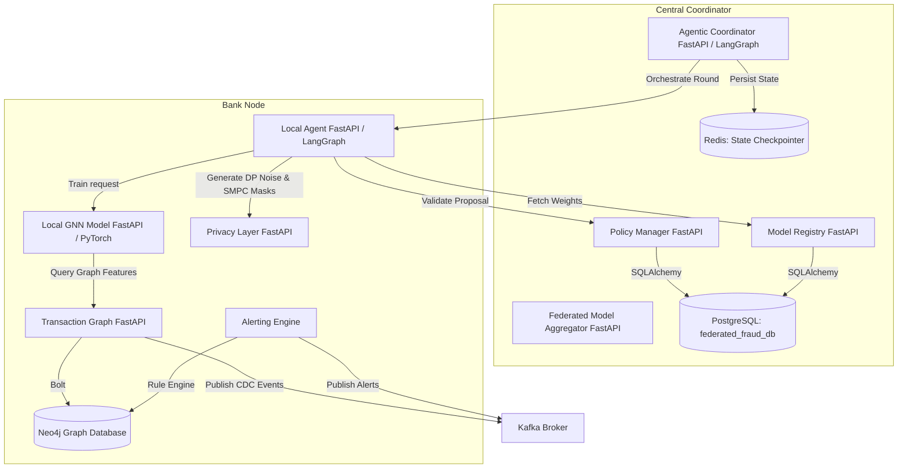
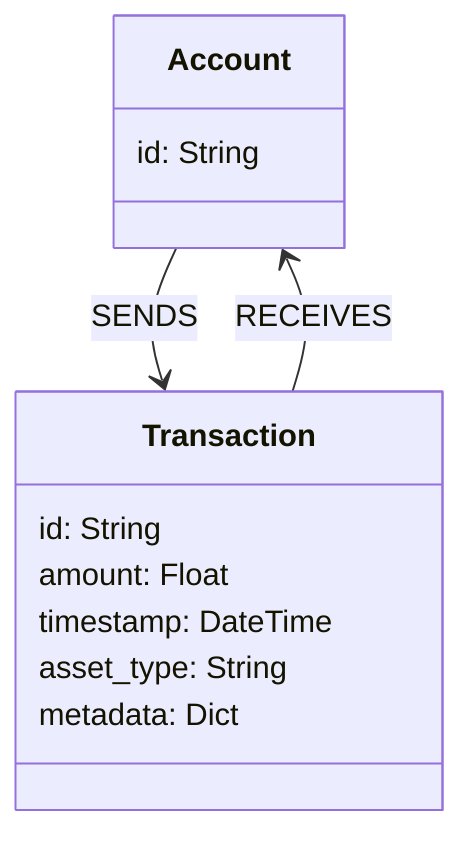
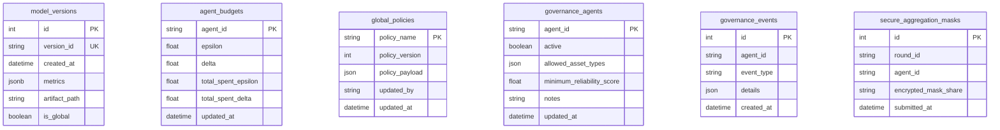

# Federated CBDC Fraud Detection System: Flow and Architecture Guide

This document provides a comprehensive, end-to-end breakdown of how the **Bank Nodes** and the **Central Coordinator** operate within this privacy-preserving federated fraud detection system. It includes in-depth details of the microservice components, data workflows, and complete database specifications (including Neo4j, PostgreSQL, Redis, and Kafka).

---

## Conceptual Overview

### 1. The Core Problem: Why is Fraud Hard to Detect?
In a Central Bank Digital Currency (CBDC) system, money flows across multiple commercial banks. Traditional systems try to spot fraud by having each bank look at its own database. However, modern financial criminals split their activities across multiple banks (known as *structuring* or *money laundering loops*) to avoid detection. 

Ideally, banks would pool all their transaction records together into one massive database to spot these patterns. But in the real world, strict financial regulations and **data privacy laws** (like GDPR) prevent banks from sharing raw customer transaction data with each other or with a third party.

### 2. The Solution: Federated Learning (FL)
**Federated Learning** is a smart way of training AI models without sharing raw data. Instead of sending all private transaction data to a central server:
1. The central coordinator sends a basic, blank AI model to each participating bank.
2. Each bank trains the model **locally** using only its own private customer data.
3. The bank sends only the **model learnings** (mathematical adjustments or "weights") back to the central coordinator. **No raw transaction data ever leaves the bank.**
4. The coordinator merges these learnings together to create a master "global model" that has learned from all banks' patterns.
5. The coordinator sends the master model back to the banks, helping them detect fraud far better than they could alone.

### 3. Graph Neural Networks (GNNs): Seeing the Connections
Most traditional AI models look at data in tables—like rows in a spreadsheet. But transactions are fundamentally a web of connections.
*   **Graph Databases (Neo4j)** store transaction data as a map of circles (**Nodes** representing accounts or transactions) and arrows (**Edges** representing money sent and received).
*   **Graph Neural Networks (GNNs)** are special AI models designed to learn from these maps. Instead of just looking at transaction sizes, they trace *how* money moves—detecting multi-step loops, shell accounts, and structuring rings that table-based algorithms miss.

### 4. Privacy-Preserving Technologies
To guarantee that the model learnings sent by the banks cannot be reverse-engineered to reveal private transactions, the system uses two main tools:
*   **Local Differential Privacy (LDP)**: The bank adds a tiny amount of mathematical "noise" to the model learnings before sending them, making it impossible to pin down any single transaction.
*   **Secure Multiparty Computation (SMPC) Masking**: The bank scrambles its model learnings with paired mathematical masks before sending them. When the central coordinator averages all the scrambled files together, the masks mathematically cancel each other out (similar to $+5$ and $-5$ equaling $0$), revealing the clean average learnings without the coordinator ever seeing the original unscrambled files.

---

---

## Part 1: Bank Node Operations & Data Architecture

A **Bank Node** acts as a decentralized node (typically running inside a commercial bank's secure infrastructure) responsible for local CBDC transaction graph management, model training, and privacy-preserving federated updates.

### 1. Component Flows & Operations

The Bank Node uses five primary microservices to run the federated learning (FL) loop locally:

*   **`local-agent` (Local Orchestrator)**:
    *   Exposes APIs to start local training cycles triggered by the Central Coordinator.
    *   Uses a **LangGraph State Machine** to manage the execution steps:
        1.  *Data Readiness Check*: Queries local transaction datastores to confirm training graphs exist.
        2.  *Global Model Sync*: Fetches the latest global weights from the Central Coordinator's registry.
        3.  *Trigger Training*: Offloads training workload to `local-gnn-model`.
        4.  *Apply Privacy*: Involves the `privacy-layer` to execute differential privacy noise additions and secure multiparty aggregation masking.
        5.  *Submission*: Transmits the protected local model parameters back to the coordinator.
*   **`local-gnn-model` (GNN Model & Trainer)**:
    *   Encapsulates the PyTorch Geometric (PyG) Graph Neural Network classifier.
    *   Loads local node-feature tables and transaction edge list shards.
    *   Enriches node embeddings by extracting and appending network structural features (in-degree, out-degree, total-degree, degree absolute differences, and neighborhood metrics).
    *   Trains a hybrid GNN (utilizing architectures like GAT, GCN, or custom classifiers) to detect illicit transaction patterns.
*   **`privacy-layer` (Privacy and Cryptography)**:
    *   Applies **Local Differential Privacy (LDP)** by perturbing local model gradients/weights with Gaussian noise according to the global privacy budget.
    *   Implements **Secure Multiparty Computation (SMPC)** masking. It generates pairwise masks using shared key seeds to guarantee that individual model contributions cannot be reverse-engineered during aggregation.
*   **`transaction-graph` (Graph Gateway)**:
    *   Exposes FastAPI endpoints to register incoming transactions and query graph structures.
    *   Translates incoming transaction payloads into Cypher graph queries and writes them to Neo4j.
    *   Publishes Change Data Capture (CDC) events to Kafka topics for real-time alerting.
*   **`alerting` (Alerting Engine)**:
    *   Subscribes to raw transaction streams from Kafka.
    *   Queries local accounts and counterparties to check against transaction velocity limits and historical risk ratings.
    *   Publishes fraud alerts back to the Kafka broker.

---

### 2. Bank Node Database Specifications

#### A. Neo4j Graph Database
*   **Role**: Persistent storage of local CBDC transaction ledgers, network structures, and counterparty relationships.
*   **Database Schema**:
    *   **Nodes**:
        *   `Account` (label: `:Account`, properties: `{id: String}`)
        *   `Transaction` (label: `:Transaction`, properties: `{id: String, amount: Float, timestamp: String, asset_type: String}`)
    *   **Relationships**:
        *   `(:Account)-[:SENDS]->(:Transaction)`
        *   `(:Transaction)-[:RECEIVES]->(:Account)`
*   **Calculated Graph Metrics**:
    *   *Degree Centrality*: Incoming/outgoing counts of transactions per account.
    *   *Reciprocal Counterparties*: Identifies mutual loops where accounts send and receive back and forth.
    *   *Two-Hop Reachability*: Count of reachable accounts within a depth of 2 edges to capture structuring/layering activities.
*   **Ports & Protocols**:
    *   `7687` (Bolt Protocol) - Used by `transaction-graph` and `local-gnn-model` for database queries.
    *   `7474` (HTTP) - Console port for operators to inspect the graph structure.

#### B. Apache Kafka Broker
*   **Role**: Asynchronous event streaming backbone for real-time transaction forwarding, Change Data Capture (CDC), and live fraud alerts.
*   **Participating Services & Data Flow**:
    *   **[transaction-graph](file:///Users/dusman/Documents/MSC/research/research-development/agentic-federated-cbdc-fraud-detection/bank-node/transaction-graph/src/main.py)**: Acts as a **producer** for the `transactions.events` topic.
    *   **[alerting](file:///Users/dusman/Documents/MSC/research/research-development/agentic-federated-cbdc-fraud-detection/bank-node/alerting/)**: Acts as a **consumer** for `transactions.events` and a **producer** for `fraud.alerts`.
    *   **[fraud-dashboard](file:///Users/dusman/Documents/MSC/research/research-development/agentic-federated-cbdc-fraud-detection/bank-node/fraud-dashboard/)**: Acts as a **consumer** for `fraud.alerts` to feed the frontend interface.
*   **Managed Topics**:
    *   `transactions.events`: Receives raw transaction JSON payloads representing cash movements.
    *   `fraud.alerts`: Receives confidence scores, GNN probabilities, and flag warnings for suspicious transactions.
*   **Detailed Kafka Use Cases in this Project**:
    *   **Use Case 1: Transaction Ingestion and Asynchronous Decoupling (CDC)**
        *   When a client issues a transaction via `POST /transactions`, the `transaction-graph` service registers it in Neo4j and immediately publishes the event to `transactions.events`. This allows the bank node to settle transactions instantly in its database without waiting for computationally heavy fraud analysis.
    *   **Use Case 2: Asynchronous Real-Time Fraud Checking**
        *   The `alerting` service consumes transaction logs from `transactions.events` in real-time, queries local account history, runs checks, and evaluates transactions against GNN metrics. It then produces output to the `fraud.alerts` topic.
    *   **Use Case 3: Live Operator Alert Stream**
        *   The React Dashboard relies on Kafka's streaming capability to refresh charts and alert logs in real-time. By subscribing to the `fraud.alerts` topic, the dashboard receives push-updates instead of constantly querying the database (long-polling), keeping it fast and lightweight.
    *   **Use Case 4: Fault Tolerance and Load Buffering**
        *   If the local network faces a peak load (high transactions per second) or the GNN model inference engine restarts, Kafka buffers the records in its persistent topic logs. When the alerting consumers catch up, they pick up exactly from their last committed offset, ensuring zero data loss.
*   **Ports & Config**:
    *   `9092` - Broker client connection port.
    *   `2181` - Zookeeper metadata coordinator port.
    *   `8080` - Kafka UI console port.

---
---

## Part 2: Central Coordinator Operations & Data Architecture

The **Central Coordinator** is the administrative control plane of the federated system. It oversees agent authorization, tracks the model registry, updates network policies, and aggregates client weight updates into the global GNN model.

### 1. Component Flows & Operations

The Central Coordinator utilizes four primary services:

*   **`agentic-coordinator` (Global Orchestrator)**:
    *   Managed by a **LangGraph State Machine** to coordinate federated training rounds:
        1.  *Load Policies*: Requests global constraints and delta threshold matrices from `policy-manager`.
        2.  *Peer Weight Negotiation*: Requests local performance metrics from active Bank Nodes, negotiates aggregation weights, and verifies convergence.
        3.  *Collect Updates*: Receives encrypted and masked local model weights from participating banks.
        4.  *Trigger Aggregation*: Sends masks and weight maps to the `federated-model-aggregator` to build the new global model.
        5.  *Evaluate Consensus*: Manages multi-agent voting protocols when new fraud patterns are proposed.
*   **`federated-model-aggregator` (Aggregation Engine)**:
    *   Implements core federated learning algorithms, including **FedAvg** and **WeightedFedAvg**.
    *   Combines the collected client weights securely. Because clients use paired SMPC masks, the individual client masks cancel out mathematically when aggregated, leaving only the clean, averaged global weights.
*   **`policy-manager` (Governance & Privacy Auditing)**:
    *   Enforces access control rules for Bank Nodes.
    *   Maintains the versioned global policies (e.g. minimum accuracy, maximum loss delta, DP noise bounds).
    *   Tracks the cumulative differential privacy budget spent by each Bank Node.
*   **`model-registry` (Model Database Interface)**:
    *   Stores global model states and registers version IDs.
    *   Saves the actual model weights (e.g., `v-*.pt` files) directly to the persistent filesystem storage `/app/artifacts` (which maps to the local host directory).

---

### 2. Central Coordinator Database Specifications

#### A. PostgreSQL Relational Database (`federated_fraud_db`)
*   **Role**: Relational database for metadata tracking, governance logs, and system audit trails.
*   **Managed Tables**:

##### Table: `model_versions` (Managed by `model-registry`)
Stores records of all registered model iterations, paths to PyTorch state files, and performance metrics.
*   `id` (Integer, Primary Key, Auto-increment)
*   `version_id` (String, Unique, Not Null) - Unique identifier (e.g., `v-20260616143244-uuid`)
*   `created_at` (DateTime with timezone, Not Null)
*   `metrics` (JSONB, Not Null) - Stores performance metrics like `{"accuracy": 0.85, "f1_score": 0.82}`
*   `artifact_path` (String, Not Null) - Path to the persistent `.pt` binary file
*   `is_global` (Boolean, Not Null) - Identifies whether this is a centralized aggregated model or an agent-local update

##### Table: `agent_budgets` (Managed by `policy-manager`)
Audits privacy budgets allocated and spent for differential privacy accounting.
*   `agent_id` (String, Primary Key)
*   `epsilon` (Float, Not Null) - Total epsilon limit
*   `delta` (Float, Not Null) - Total delta limit
*   `total_spent_epsilon` (Float, Not Null, Default: `0.0`) - Accumulated epsilon privacy budget consumed
*   `total_spent_delta` (Float, Not Null, Default: `0.0`) - Accumulated delta privacy budget consumed
*   `updated_at` (DateTime with timezone, Not Null)

##### Table: `global_policies` (Managed by `policy-manager`)
Versioned configuration registry containing training hyper-parameters, thresholds, and strategies.
*   `policy_name` (String, Primary Key)
*   `policy_version` (Integer, Not Null, Default: `1`)
*   `policy_payload` (JSON, Not Null) - Holds keys like `min_update_accuracy`, `min_agents_per_round`, `require_encrypted_updates`
*   `updated_by` (String, Not Null, Default: `"system"`)
*   `updated_at` (DateTime with timezone, Not Null)

##### Table: `governance_agents` (Managed by `policy-manager`)
White-list registry of authorized banking nodes.
*   `agent_id` (String, Primary Key)
*   `active` (Boolean, Not Null, Default: `True`)
*   `allowed_asset_types` (JSON, Not Null) - Allowed settlement types (e.g., `["CBDC"]`)
*   `minimum_reliability_score` (Float, Not Null) - Minimal historical submission rate required
*   `notes` (String, Nullable)
*   `updated_at` (DateTime with timezone, Not Null)

##### Table: `governance_events` (Managed by `policy-manager`)
Immutable audit trail for critical system actions (e.g. consensus votes, policy changes, round completions).
*   `id` (Integer, Primary Key, Auto-increment)
*   `agent_id` (String, Nullable) - Proposer or voter agent ID
*   `event_type` (String, Not Null) - Event name (e.g. `"consensus_approval"`, `"policy_updated"`)
*   `details` (JSON, Not Null) - Structured log details
*   `created_at` (DateTime with timezone, Not Null)

##### Table: `secure_aggregation_masks` (Managed by `policy-manager`)
Holds client-submitted cryptographic mask shares during the SMPC phase.
*   `id` (Integer, Primary Key, Auto-increment)
*   `round_id` (String, Not Null)
*   `agent_id` (String, Not Null)
*   `encrypted_mask_share` (String, Not Null)
*   `submitted_at` (DateTime with timezone, Not Null)

*   **Ports**:
    *   `5432` - Cluster internal port.
    *   `5435` - Exposed host port forwarded to enable external pgAdmin connection.

#### B. Redis Key-Value Cache
*   **Role**: Serves as the state checkpointer database for the `agentic-coordinator` FastAPI and LangGraph workflows.
*   **Features**:
    *   Ensures that global orchestrator nodes can recover training round states, active participant sets, and step sequences in the event of pod failures.
*   **Port**: `6379`.

---
---

## Part 3: Federated Training Data & Preparation Flow

The system leverages the **Elliptic++ Dataset** (a graph network of Bitcoin blockchain transactions and wallet addresses) to simulate realistic decentralized GNN training in a federated CBDC environment.

---

### 1. Source Data Structures

The raw training dataset is located inside the [train-data](file:///Users/dusman/Documents/MSC/research/research-development/agentic-federated-cbdc-fraud-detection/train-data) directory:

#### A. Transactions Dataset (Money Flow Graph)
*   **`txs_features.csv`**: Contains **182 local and structural features** for each transaction (such as transaction fee, input/output counts, one-hop and two-hop neighborhood coefficient averages), along with a `Time step` (ranging from `1` to `49`).
*   **`txs_classes.csv`**: Contains ground-truth classification labels for all transactions:
    *   `1`: Illicit (fraudulent / suspicious)
    *   `2`: Licit (legitimate)
    *   `3`: Unknown (unlabeled)
*   **`txs_edgelist.csv`**: Defines the money flow graph edges between transactions (`txId1` -> `txId2`).

#### B. Actors Dataset (Wallet Address Interaction Graph)
*   **`wallets_features.csv`**: Contains **55 wallet-level features** (such as degree, transaction counts, and balance statistics).
*   **`wallets_classes.csv`**: Contains actor labels: `1` (illicit), `2` (licit), or `3` (unknown).
*   **`AddrAddr_edgelist.csv`**, **`AddrTx_edgelist.csv`**, and **`TxAddr_edgelist.csv`**: Define direct wallet-to-wallet interactions and bipartite mappings between wallets and transactions.

---

### 2. Data Preparation Pipeline

The [data_preparation.py](file:///Users/dusman/Documents/MSC/research/research-development/agentic-federated-cbdc-fraud-detection/train-data/data_preparation.py) script processes and structures this raw data for GNN consumption:

1.  **Feature and Class Merging**: Merges features and class label tables on the key fields (`txId` for transactions and `address` for wallets).
2.  **Feature Scaling**: Standardizes the feature matrices using `StandardScaler` (z-score scaling) to scale numeric vectors, excluding identifiers (`txId`/`address`), `Time step`, and target `class` columns.
3.  **Simulated Federated Split (Decentralized Sharding)**:
    *   To simulate different banks operating independently, the script partitions the 49 time-steps temporally into `n_shards` non-overlapping segments (default is 4).
    *   It outputs 4 separate data shards: `txs_shard_1.csv` through `txs_shard_4.csv` under [train-data/processed/](file:///Users/dusman/Documents/MSC/research/research-development/agentic-federated-cbdc-fraud-detection/train-data/processed).
    *   *Example*: Bank Node 1 trains local updates using `txs_shard_1.csv` (early time steps), while Bank Node 2 trains on `txs_shard_2.csv` (middle time steps), preventing data leakage between nodes while maintaining temporal local training integrity.

---

### 3. Data Consumption by Bank Node Services

The GNN trainer service **[local-gnn-model](file:///Users/dusman/Documents/MSC/research/research-development/agentic-federated-cbdc-fraud-detection/bank-node/local-gnn-model/src/main.py)** directly consumes the prepared dataset for local training and inference:

*   **Variables Configured**:
    *   `TX_SHARD_PATH`: Location of the node data shard (defaults to `train-data/processed/txs_shard_1.csv`).
        *   > [!TIP]
        *   > **Multi-Node Identifier**: To scale this system and run multiple Bank Nodes, configure this environment variable for each Bank Node deployment to point to a different shard file (e.g., Bank Node 2 points to `txs_shard_2.csv`, Bank Node 3 to `txs_shard_3.csv`). This prevents nodes from reading the same training dataset.
    *   `TX_EDGES_PATH`: Location of the graph edge list (defaults to `train-data/processed/txs_edges_processed.csv`).
    *   `TX_CLASSES_PATH`: Location of the target labels (defaults to `train-data/EllipticPlusPlus-main/Transactions Dataset/txs_classes.csv`).
*   **GNN Processing Steps**:
    1.  Loads node feature matrices and filters edges down to only those matching the node IDs in the local shard.
    2.  Converts the transaction classes mapping (`1` -> `1`, `2` -> `0`, `3` -> `2`) to construct target labels `y` for PyTorch.
    3.  Builds the PyTorch Geometric **`Data`** object containing local node features (`x`), graph structural edges (`edge_index`), class labels (`y`), and transaction IDs (`tx_ids`).
    4.  Runs standard training epochs locally to compute training metrics (Loss, Accuracy, F1-Score) and output optimized model weights.

---

## Part 4: Data Read/Write Lifecycle & State Persistence

This section details how the Bank Nodes and Central Coordinator manage runtime states, trained weights, datasets, and schema configurations under both stateless and persistent requirements.

### 1. Bank Node Data Flow (Stateless & Read-Only)

To support isolation and elastic scalability, the local processing services inside each Bank Node are designed to operate as **100% stateless** memory runtimes during federated rounds.

#### A. Model Weights & Training State (In-Memory Processing)
Neither the GNN training node nor the local agent persists `.pt` model weights or training metrics onto their local container filesystems.

*   **`local-gnn`**: When a training step is invoked via `POST /train`, the service receives the starting global model weights as raw binary parameters sent over the network. It loads these weights into PyTorch using memory buffers (`io.BytesIO`), executes the training epochs, and serializes the optimized local weights back to an in-memory buffer to return as the HTTP response payload.
    *   *Reference:* [trainer.py:L119-L129](file:///Users/dusman/Documents/MSC/research/research-development/agentic-federated-cbdc-fraud-detection/bank-node/local-gnn-model/src/trainer.py#L119-L129) (`get_model_weights` & `set_model_weights`)
*   **`local-agent`**: Orchestrates state transitions entirely within Python memory maps. Local updates are kept in a runtime dictionary (`agent_status`), and Differential Privacy perturbation and symmetric AES-Fernet encryption are executed as in-memory streams prior to sending updates to the coordinator.

#### B. GNN Training Datasets (Read-Only CSV Shards)
To execute local GNN training steps, `local-gnn` maps static transaction features and edge structures from read-only files. The default local data directory paths inside the service container are:

| Data Type | Environment Variable | Default File Path | Description |
|---|---|---|---|
| **Node Features Shard** | `TX_SHARD_PATH` | `train-data/processed/txs_shard_1.csv` | Transaction node features mapped to this specific bank partition |
| **Graph Edges** | `TX_EDGES_PATH` | `train-data/processed/txs_edges_processed.csv` | Structural transaction relationship links |
| **Labels & Classes** | `TX_CLASSES_PATH` | `train-data/EllipticPlusPlus-main/Transactions Dataset/txs_classes.csv` | Target fraud classification mapping labels |

*   *Reference:* [main.py:L102-L115](file:///Users/dusman/Documents/MSC/research/research-development/agentic-federated-cbdc-fraud-detection/bank-node/local-gnn-model/src/main.py#L102-L115) (`_resolve_default_paths`)

---

### 2. Central Coordinator Storage Flow (Hybrid Persistence)

In contrast to the stateless Bank Nodes, the Central Coordinator implements a **hybrid persistence** architecture to guarantee that global GNN updates, audit logs, and version control are preserved across service restarts and scale-ups.

#### A. Model Metadata Tracking (Relational Database)
All global version records, model metrics, registration dates, and reference paths are recorded in PostgreSQL (`federated_fraud_db`) inside the `model_versions` table.

*   **Database Interface**: SQLAlchemy ORM + PostgreSQL client driver
*   **Tracked Schema**:
    *   `version_id`: Unique version tag (e.g., `v-20260616050647-cvf8k`) generated using a combination of the current UTC date and random characters.
    *   `created_at`: The exact registration timestamp.
    *   `metrics`: PostgreSQL `JSONB` column containing raw dictionaries of aggregated scores (e.g., `{"accuracy": 0.93, "f1_score": 0.88, ...}`).
    *   `artifact_path`: Host file path pointing to where the weights binary is stored.
    *   `is_global`: Flag identifying whether the model is a final aggregated global version or an intermediate step.

#### B. Model Weights Binary (Disk & Persistent Volume Storage)
The actual model weight tensors are stored directly on disk using PyTorch binary serialization:

*   **Base64 Decoding**: When `model-registry` receives the model weights as a Base64-encoded string, it decodes it and writes the binary content to a `.pt` file (e.g., `v-*.pt`).
*   **Kubernetes Persistence**: To prevent loss of model checkpoints when pods recycle, the weight folder (`ARTIFACT_DIR`, defaulting to `/app/artifacts`) is backed by a Kubernetes Persistent Volume Claim (PVC) (`model-registry-pvc`), persisting training runs indefinitely.
*   *Reference:* [main.py:L75-L85](file:///Users/dusman/Documents/MSC/research/research-development/agentic-federated-cbdc-fraud-detection/central-coordinator/model-registry/src/main.py#L75-L85) (model weight persistence routine)

