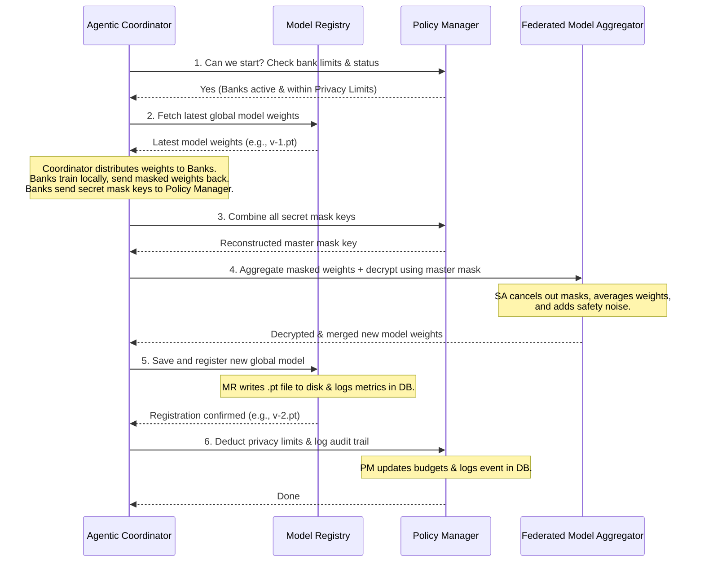

# Central Coordinator Flow

This document explains the end-to-end orchestration flow within the Central Coordinator, detailing how the `agentic-coordinator`, `model-registry`, `policy-manager`, and `federated-model-aggregator` collaborate to execute a secure, privacy-preserving federated training round.

---

## The Secure Multiparty Computation (SMPC) Masking Concept

To protect user privacy, the system uses cryptographic masking so the central server never sees any single bank's raw AI learnings.

### The Problem:
If a bank sends its raw model updates ($A$ or $B$) to the central coordinator, the coordinator could potentially reverse-engineer the model to steal sensitive, private customer transaction data.

### The Solution:
1. **Local Masking:** Each bank creates its own secret mathematical mask ($M_A$ for Bank A, $M_B$ for Bank B). Before sending its updates, the bank adds its mask to the weights:
   - **Bank A sends:** $A + M_A$ (Scrambled Update A)
   - **Bank B sends:** $B + M_B$ (Scrambled Update B)

2. **Summing the Scrambled Data:** The coordinator collects these updates and sums them:
   $$\text{Scrambled A} + \text{Scrambled B} = (A + M_A) + (B + M_B) = (A + B) + (M_A + M_B)$$
   
   Because of the masks, the coordinator cannot see the actual values of $A$ or $B$.

3. **The Master Mask Key:** To recover the clean merged model $(A + B)$, the coordinator must subtract the combined masks: $(M_A + M_B)$. This combined mask is called the **Master Mask Key** (or *Aggregate Mask*).

4. **Division of Labor:**
   - The **Policy Manager** collects the individual masks ($M_A, M_B$), combines them into the **Master Mask Key** $(M_A + M_B)$, and sends only this combined key to the coordinator.
   - The **Federated Model Aggregator** takes the scrambled updates and subtracts the Master Mask Key, revealing the clean average global model $(A + B)$ without any single service seeing the raw unmasked inputs from any bank.

---

## Detailed Training Round Sequence

### Step-by-Step Breakdown

### 1. Pre-Training Safety Check
* **Sender:** `Agentic Coordinator`
* **Recipient:** `Policy Manager`
* **Details:** The coordinator asks if the participating banks are authorized to train and if they have enough **Privacy Limit** allowance (Epsilon $\epsilon$ and Delta $\delta$). If any bank has exceeded its safety limit, the Policy Manager rejects the round to prevent data leaks.

### 2. Fetching Base Weights
* **Sender:** `Agentic Coordinator`
* **Recipient:** `Model Registry`
* **Details:** The coordinator fetches the weights of the current global model (e.g., `v-1.pt`) to send to the banks as the starting point for their training.

### 3. Local Training & Scrambling (Bank Nodes)
* **Sender:** `local-agent` (on the Bank Node)
* **Recipient:** `Agentic Coordinator` (which then forwards the mask share to the `Policy Manager`)
* **Details:**
  - The `local-agent` coordinates with `local-gnn-model` to train the GNN model using the bank's private transactions.
  - The `local-agent` uses the `privacy-layer` to generate local secure aggregation masks ($M_i$) and add differential privacy noise.
  - The `local-agent` sends a unified `UpdateSubmission` payload to the `Agentic Coordinator` containing:
    - **Scrambled & encrypted weights** (local AI learnings combined with the local mask).
    - **Encrypted mask share** ($M_i$).
    - **Metrics** (accuracy, loss, sample size) and validation metadata.
  - The `Agentic Coordinator` intercepts this request and automatically forwards the **encrypted mask share** to the `Policy Manager` via the `POST /secure-aggregation/masks/submit` endpoint.

### 4. Creating the Master Mask Key
* **Sender:** `Agentic Coordinator`
* **Recipient:** `Policy Manager`
* **Details:** The Coordinator requests the combined mask key for the current round using `/secure-aggregation/masks/aggregate`. The Policy Manager decrypts all individual mask shares, computes the weighted sum, and returns the combined **Master Mask Key**.

### 5. Federated Model Aggregation
* **Sender:** `Agentic Coordinator`
* **Recipient:** `Federated Model Aggregator`
* **Details:** The Coordinator passes the masked weights and the Master Mask Key to the Federated Model Aggregator. The Federated Model Aggregator subtracts the Master Mask Key from the summed weights to reveal the clean, decrypted average model. It then adds a layer of Gaussian noise (Differential Privacy) to ensure the outputs cannot be reverse-engineered.

### 6. Registering the New Model Version
* **Sender:** `Agentic Coordinator`
* **Recipient:** `Model Registry`
* **Details:** The Coordinator registers the decrypted and aggregated weights with the Model Registry. The Model Registry writes the weights binary (e.g. `v-2.pt`) to disk and logs the version metadata and metrics in PostgreSQL.

### 7. Deducting Privacy Limits
* **Sender:** `Agentic Coordinator`
* **Recipient:** `Policy Manager`
* **Details:** The Coordinator requests a privacy limit deduction for the round. The Policy Manager subtracts the Epsilon/Delta consumed during the round from each bank's balance and logs an immutable audit event in the database for compliance.
