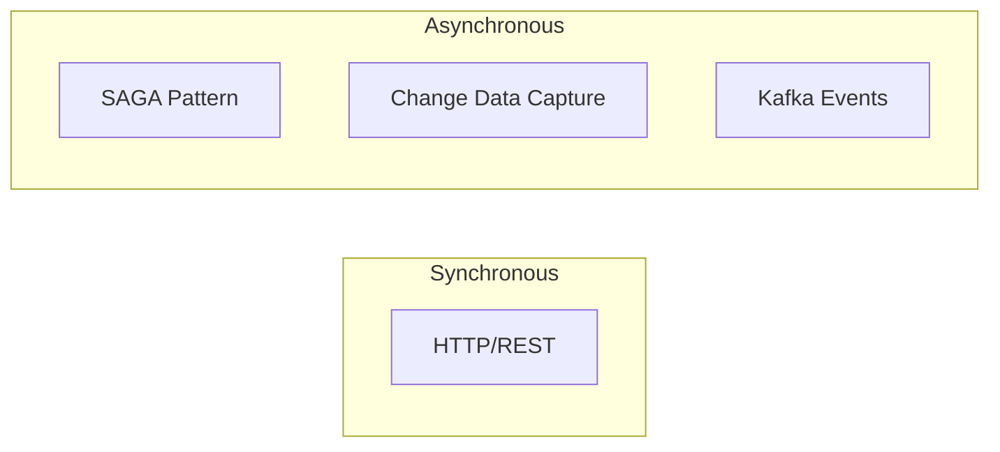
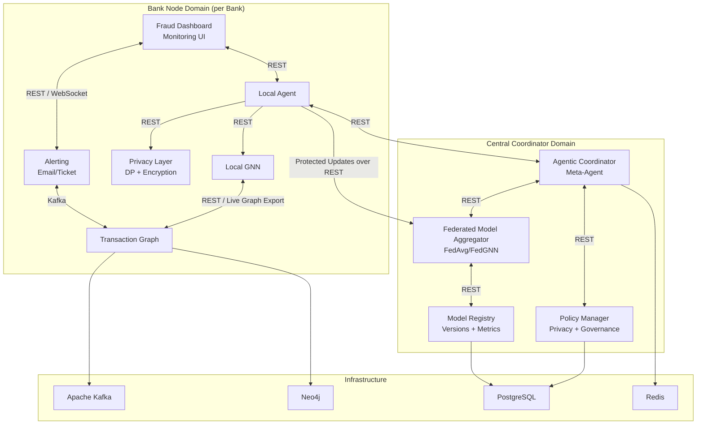
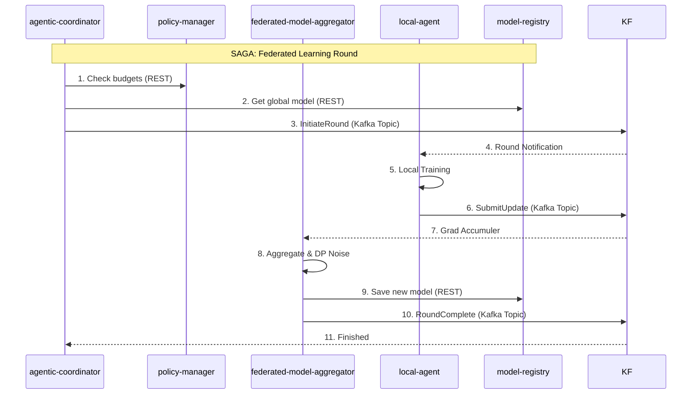

# Development Plan
## Agentic Federated Learning Framework for CBDC Fraud Detection

**Version:** 2.0  
**Created:** February 2026  
**Updated:** June 24, 2026  
**Status:** MVP Running with Core Design-Gap Fixes Applied  
**Architecture:** Microservice Architecture

> [!IMPORTANT]
> This document combines the **current MVP implementation plan** with a **target-state roadmap**. The current prototype uses REST for the federated control plane, Kafka for transaction and alert streams, PostgreSQL-backed policy/registry/alert metadata, Redis-backed coordinator workflow state when configured, and local-disk or S3/MinIO model artifacts. References to SAGA, Flower, Debezium, and other advanced extensions should be read as future-evolution options unless a status note says they are already implemented.

---

## 1. Architecture Overview

### 1.1 Microservice Architecture Principles

| Principle | Description |
|-----------|-------------|
| **Independent Deployment** | Each service has its own codebase and can be deployed independently |
| **Domain Grouping** | Services are grouped by domain (Coordinator / Bank Node) |
| **Communication Patterns** | Sync: REST; Async: Kafka (CDC) |
| **Technology Agnostic** | Each service can use different technologies as needed |
| **Loose Coupling** | Services communicate via well-defined APIs and events |

### 1.2 Service Communication Patterns



| Pattern | Use Case |
|---------|----------|
| **HTTP/REST** | CRUD operations, dashboard APIs, and the current federated round control plane |
| **SAGA** | Target-state option for richer distributed training workflows |
| **CDC** | Transaction streaming and real-time data propagation |

### 1.3 High-Level Architecture



---

## 2. Microservice Definitions

### 2.1 Central Coordinator Services (4 Services)

| # | Service | Description | Port | Protocol |
|---|---------|-------------|------|----------|
| 1 | **Agentic Coordinator** | Meta-Agent for FL orchestration | 8001 | REST + Kafka |
| 2 | **Federated Model Aggregator** | FedAvg/FedGNN model aggregation | 8002 | REST + Kafka |
| 3 | **Policy Manager** | Privacy budgets + Governance | 8003 | REST |
| 4 | **Model Registry** | Model versions + Metrics | 8004 | REST |

### 2.2 Bank Node Services (6 Services)

| # | Service | Description | Port | Protocol |
|---|---------|-------------|------|----------|
| 5 | **Local Agent** | Autonomous training agent | 9001 | REST + Kafka |
| 6 | **Local GNN** | GNN training & inference | 9002 | REST |
| 7 | **Privacy Layer** | DP + Encryption | 9003 | REST |
| 8 | **Transaction Graph** | Graph construction + CDC | 9004 | REST + CDC |
| 9 | **Fraud Dashboard** | Monitoring UI | 3001 | HTTP/REST |
| 10 | **Alerting** | Email/Ticket notifications | 9005 | Kafka |

---

## 3. Project Structure (Microservice)

```
agentic-federated-cbdc-fraud-detection/
│
├── central-coordinator/                  # Central Coordinator Domain
│   ├── agentic-coordinator/              # Service 1
│   │   ├── src/
│   │   ├── tests/
│   │   ├── Dockerfile
│   │   ├── pyproject.toml
│   │   └── README.md
│   ├── federated-model-aggregator/       # Service 2
│   │   ├── src/
│   │   ├── tests/
│   │   ├── Dockerfile
│   │   ├── pyproject.toml
│   │   └── README.md
│   ├── policy-manager/                   # Service 3
│   │   ├── src/
│   │   ├── tests/
│   │   ├── Dockerfile
│   │   ├── pyproject.toml
│   │   └── README.md
│   └── model-registry/                   # Service 4
│       ├── src/
│       ├── tests/
│       ├── Dockerfile
│       ├── pyproject.toml
│       └── README.md
│
├── bank-node/                            # Bank Node Domain
│   ├── local-agent/                      # Service 5
│   │   ├── src/
│   │   ├── tests/
│   │   ├── Dockerfile
│   │   ├── pyproject.toml
│   │   └── README.md
│   ├── local-gnn-model/                  # Service 6
│   │   ├── src/
│   │   ├── tests/
│   │   ├── Dockerfile
│   │   ├── pyproject.toml
│   │   └── README.md
│   ├── privacy-layer/                    # Service 7
│   │   ├── src/
│   │   ├── tests/
│   │   ├── Dockerfile
│   │   ├── pyproject.toml
│   │   └── README.md
│   ├── transaction-graph/                # Service 8
│   │   ├── src/
│   │   ├── tests/
│   │   ├── Dockerfile
│   │   ├── pyproject.toml
│   │   └── README.md
│   ├── fraud-dashboard/                  # Service 9
│   │   ├── src/
│   │   ├── public/
│   │   ├── Dockerfile
│   │   ├── package.json
│   │   └── README.md
│   └── alerting/                         # Service 10
│       ├── src/
│       ├── tests/
│       ├── Dockerfile
│       ├── pyproject.toml
│       └── README.md
│
├── shared/                               # Shared Resources
│   ├── contracts/                        # Shared REST/OpenAPI contract assets
│   ├── schemas/                          # Shared Pydantic/JSON schemas
│   └── contracts/                        # API contracts (OpenAPI)
│
├── infrastructure/                       # Infrastructure as Code
│   ├── docker-compose.yml                # Local development
│   ├── docker-compose.dev.yml            # Dev overrides
│   ├── kubernetes/                       # K8s manifests
│   └── helm/                             # Helm charts
│
├── data/                                 # Data (not in services)
│   ├── raw/
│   ├── processed/
│   └── simulated/
│
├── doc/                                  # Documentation
│   ├── design/
│   ├── status/
│   └── api/
│
├── notebooks/                            # Research notebooks
└── scripts/                              # Utility scripts
```

---

## 4. Service Specifications

### 4.1 Agentic Coordinator (Meta-Agent)

```yaml
service: agentic-coordinator
domain: coordinator
port: 8001
protocols:
  - REST (sync APIs)
  - Kafka (inter-node)
technology:
  - Python 3.11+
  - FastAPI
  - LangGraph/LangChain
responsibilities:
  - Orchestrate federated learning rounds
  - Select participating bank nodes
  - Adaptive scheduling based on node performance
  - Policy-aware gating, runtime readiness checks, and suspicious-update screening
  - Persist/restore workflow state snapshots
communication:
  - REST → Federated Model Aggregator (Internal)
  - REST → Policy Manager (Internal)
  - REST ↔ Local Agents (External)
dependencies:
  - Policy Manager
  - Model Registry
  - Redis (workflow durability when configured)
```

### 4.2 Federated Model Aggregator (FedAvg/FedGNN)

```yaml
service: federated-model-aggregator
domain: coordinator
port: 8002
protocol: REST
technology:
  - Python 3.11+
  - PyTorch
  - FastAPI
responsibilities:
  - Receive protected model updates
  - Perform strategy-aware aggregation (`FedAvg`, `WeightedFedAvg`, `PerformanceWeightedFedAvg`, `AdaptiveFedAvg`)
  - Decrypt encrypted payloads when provided
  - Return aggregated global model weights
communication:
  - REST ← Agentic Coordinator (Internal)
  - REST → Model Registry (Internal)
dependencies:
  - Model Registry
```

### 4.3 Policy Manager (Privacy + Governance)

```yaml
service: policy-manager
domain: coordinator
port: 8003
protocol: REST
technology:
  - Python 3.11+
  - FastAPI
responsibilities:
  - Manage privacy budgets (ε, δ)
  - Enforce training policies
  - Track compliance metrics
  - Governance rule enforcement
communication:
  - HTTP ← All services (policy queries)
dependencies:
  - PostgreSQL (policy storage)
```

### 4.4 Model Registry (Versions + Metrics)

```yaml
service: model-registry
domain: coordinator
port: 8004
protocol: REST
technology:
  - Python 3.11+
  - FastAPI
responsibilities:
  - Store model versions
  - Track model metrics
  - Model deployment management
  - Rollback capabilities
communication:
  - HTTP ← Federated Model Aggregator
  - HTTP ← Local Agents (model pull)
dependencies:
  - PostgreSQL (metadata)
  - Local disk artifact storage
```

### 4.5 Local Agent

```yaml
service: local-agent
domain: bank-node
port: 9001
protocol: REST
technology:
  - Python 3.11+
  - LangGraph
responsibilities:
  - Autonomous training decisions
  - Coordinate local services
  - Submit model updates
  - Anomaly detection response
  - Privacy/policy/resource-aware participation gating
communication:
  - REST → Agentic Coordinator (External)
  - REST → Local GNN, Privacy Layer (Internal)
dependencies:
  - Local GNN
  - Privacy Layer
```

### 4.6 Local GNN

```yaml
service: local-gnn
domain: bank-node
port: 9002
protocol: REST
technology:
  - Python 3.11+
  - PyTorch
  - PyTorch Geometric
responsibilities:
  - Local model training
  - Fraud inference
  - Feature extraction from live transaction graphs
communication:
  - REST ← Local Agent
  - REST ↔ Transaction Graph
dependencies:
  - Transaction Graph
  - CUDA/GPU (optional)
```

### 4.7 Privacy Layer (DP + Encryption)

```yaml
service: privacy-layer
domain: bank-node
port: 9003
protocol: REST
technology:
  - Python 3.11+
  - cryptography
  - custom privacy engine
responsibilities:
  - Apply differential privacy to model weights
  - Encrypt model updates
  - Provide protected update transport utilities
  - Prepare escrowed secure updates with per-round key agreement
communication:
  - REST ← Local Agent
dependencies:
  - None (standalone)
```

### 4.8 Transaction Graph

```yaml
service: transaction-graph
domain: bank-node
port: 9004
protocols:
  - REST (queries)
  - Kafka event publication
technology:
  - Python 3.11+
  - FastAPI
  - Neo4j driver
responsibilities:
  - Build transaction graphs
  - Feature engineering
  - Real-time graph updates and event publication
communication:
  - REST ← Local GNN
  - REST → Local GNN (transaction-aligned tensor export)
  - Events → Kafka (transaction events)
  - Neo4j (graph storage)
dependencies:
  - Neo4j
  - Kafka
```

### 4.9 Fraud Dashboard (Monitoring UI)

```yaml
service: fraud-dashboard
domain: bank-node
port: 3001
protocol: HTTP
technology:
  - React.js / Next.js
  - TypeScript
  - WebSocket
responsibilities:
  - Real-time fraud monitoring
  - Analytics visualization
  - Alert management UI
communication:
  - HTTP → Local Agent
  - REST / WebSocket → Alerting
dependencies:
  - Local Agent API
  - Alerting API / WebSocket
```

### 4.10 Alerting (Email/Ticket)

```yaml
service: alerting
domain: bank-node
port: 9005
protocols:
  - REST
  - Kafka Consumer
technology:
  - Python 3.11+
  - FastAPI
responsibilities:
  - Detect suspicious transactions from transaction events
  - Generate fraud alerts
  - Email notifications
  - Ticket creation (Jira/ServiceNow)
  - Alert lifecycle management
communication:
  - Kafka ← Transaction Graph (`transactions.events`)
  - Kafka → `fraud.alerts`
  - REST → Notification Providers (Internal)
dependencies:
  - Kafka
  - PostgreSQL (alert history)
  - SMTP / Notification APIs
```

---

## 5. Technology Stack

| Component | Technology | Purpose |
|-----------|------------|---------|
| **Backend Framework** | FastAPI | REST APIs |
| **API Style** | REST/HTTP + JSON | Synchronous inter-service communication |
| **ML Framework** | PyTorch + PyG | GNN training |
| **FL Framework** | Custom REST + LangGraph orchestration | Federated round control |
| **Privacy** | Custom privacy engine + `cryptography` | Differential privacy and encrypted payload transport |
| **Agentic AI** | LangGraph | Agent orchestration |
| **Message Queue** | Apache Kafka | Event streaming |
| **CDC** | Service-level event publication | Lightweight data propagation |
| **Graph Database** | Neo4j | Transaction graphs |
| **Relational DB** | PostgreSQL | Policy, registry, and alert metadata/history |
| **Cache / State Store** | Redis + in-memory fallback | Coordinator workflow durability and runtime state |
| **Object Storage** | Local disk artifacts | Model artifacts |
| **Frontend** | React.js | Dashboard UI |
| **Container** | Docker | Service packaging |
| **Orchestration** | Kubernetes | Deployment |
| **ML Ops** | Registry service + PostgreSQL | Model version tracking |

---

## 6. Development Phases

### Phase 1: Infrastructure Setup (Week 1-2)

| Task | Priority | Days |
|------|----------|------|
| Set up development environment | Critical | 2 |
| Create microservice folder structure | Critical | 1 |
| Implement Data Preparation pipeline (Elliptic++) | High | 2 |
| Set up shared REST contracts/schemas | Critical | 2 |
| Docker Compose for local dev | High | 2 |
| Local deployment workflow hardening | High | 2 |

### Phase 2: Core Coordinator Services (Week 3-6)

| Task | Priority | Days |
|------|----------|------|
| Policy Manager | Critical | 5 |
| Model Registry | Critical | 5 |
| Federated Model Aggregator | Critical | 8 |
| Agentic Coordinator | Critical | 10 |
| SAGA workflow implementation (target-state extension) | High | 5 |

### Phase 3: Bank Node Core Services (Week 7-10)

| Task | Priority | Days |
|------|----------|------|
| Transaction Graph | Critical | 6 |
| Local GNN | Critical | 8 |
| Privacy Layer | Critical | 6 |
| Local Agent | Critical | 8 |

### Phase 4: Supporting Services (Week 11-13)

| Task | Priority | Days |
|------|----------|------|
| Alerting | High | 4 |
| Fraud Dashboard (React) | High | 8 |
| CDC pipeline setup | High | 4 |

### Phase 5: Integration & Testing (Week 14-16)

| Task | Priority | Status |
|------|----------|--------|
| Service integration tests | Critical | 🟢 Completed |
| End-to-end FL workflow | Critical | 🟢 Completed |
| Performance benchmarking | High | 🟢 Completed |
| Privacy & Security Audit | High | 🟢 Completed |

### Phase 6: Deployment (Week 17-18)

| Task | Priority | Days |
|------|----------|------|
| Kubernetes manifests | High | 4 |
| Helm charts | Medium | 3 |
| Documentation | Medium | 3 |

---

## 7. Target-State SAGA Workflow Example

### Federated Learning Round SAGA (Future Extension)



---

## 8. Milestones

| Milestone | Week | Deliverables |
|-----------|------|--------------|
| **M1: Infrastructure** | 2 | Docker Compose, local deployment workflow, folder structure |
| **M2: Coordinator MVP** | 6 | 4 coordinator services running |
| **M3: Bank Node MVP** | 10 | 4 core bank node services |
| **M4: Full System** | 13 | All 10 services integrated |
| **M5: Production Ready** | 18 | Tested, documented, deployable |

---

## 9. Next Steps

1. [ ] Expand federated aggregation beyond the current linear strategy family and strengthen adversarial update defenses
2. [ ] Advance secure aggregation toward dropout-tolerant secret-sharing or pairwise-mask recovery
3. [ ] Add label-scarce or semi-supervised live graph learning support for production-style transaction streams
4. [ ] Expand experiment tracking and evaluation artifacts for scalability, drift, privacy, and adversarial scenarios

---

*Last Updated: June 24, 2026*
